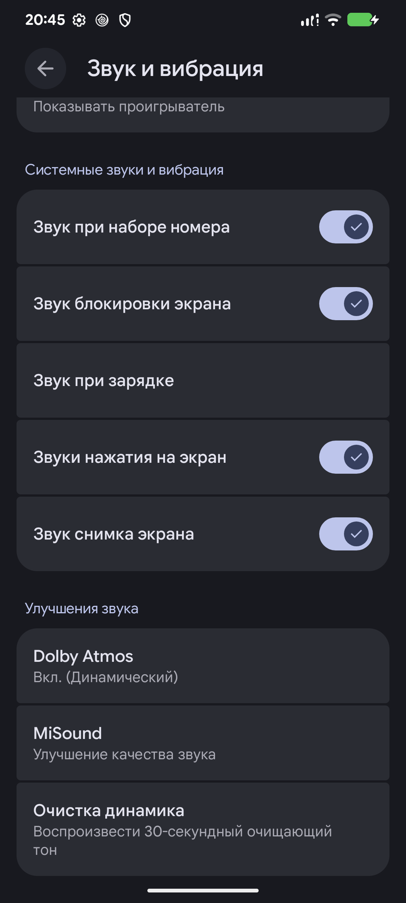

# Native recovery and full ROM verification — 2026-10-14

**Source/build/host/device-tested, scoped.** Product `lineage_alioth-cp2a-user`,
Android 17 / SDK 37, active checkout `~/evo`. Raw logs and screenshots remain
private; this record contains the decisive sanitized results.

## Source and manifest identity

Full sync resolved 1,265 projects, with 15 upstream advances. All 30 maintained
native-recovery integration heads were retained, clean and matched GitHub in the
completed baseline audit. [Exact linked heads](../state/repositories.yaml).

[Manifest repair](https://github.com/PocoF3Releases/local_manifests/commit/50ef2cbe4ca339d8591d3c00adfeb7a72e87f373)
preserves upstream project groups and build/make linkfiles. Eight clean standalone
checkouts were preserved privately before Repo recreated managed checkouts; their
approved heads were retained. Frameworks/base and frameworks/av remain on the
explicit maintained `cnb` overrides.

## Built and installed artifact

Full production build passed. Generated file:
`EvolutionX-17.0-20261013-alioth-12.3-Unofficial.zip` (filename uses build date).
SHA256: `a98d708fb8dc060457035a3596c46e493734c310e58ded87baae406752a47e52`.
Secure vendor_boot SHA256:
`194ce299e4c7e55a77078cf6aa5cd933ea6b0ee31a09460aeae44d497b4a8b82`.

Secure recovery full-ROM sideload completed with exit 0. Android subsequently
reported incremental `1791926851`, SDK 37, boot complete, slot A and SELinux
Enforcing. This confirms installation rather than merely transfer completion.
No wipe/format was performed. Secure ADB remained enabled and debuggable was 0.

## Bounded runtime acceptance

- No-credential decryption, read-only `/data`, matching plaintext fixture hash,
  crypto-service shutdown and vendor dependency unmounts passed before and after OTA.
- Signed harmless ZIP installation from decrypted storage verified its whole-file
  signature and returned recovery install status 0 after the updated ROM.
- Diagnostic init/adbd were permissive; recovery/crypto domains were enforced.
  Secure production recovery was restored on active slot A after testing.
- MiSound and Dolby opened; saved MiSound switches matched pre-update state.
  Thermal controls opened and camera activity launched. Captures retained approved UI.
- Final crash buffer was empty; the plaintext fixture hash was unchanged.
  Owned phone fixtures and temporary transfer copies were removed.
- Recovery root: 142 ELF files, zero unresolved dynamic-library dependencies.

## USB and remaining limits

An unauthorized recovery shell does not establish failed decryption. Windows ADB
server reconnect was tried; diagnostic recovery provided logs. A large fastboot
transfer lost USB before a write was reported. A hash-verified local Windows copy
with `fastboot -S 32M` restored secure recovery successfully. These are observed
host procedures, not a universal USB/kernel fix. Enter actual bootloader mode
from working Android; check product/slot/download capability before flashing.

## Final PIN and rendering update

Final incremental production build passed without installclean:
`EvolutionX-17.0-20261014-alioth-12.3-Unofficial.zip`.
SHA256: `7f36958c4f7d77a41fa2f704e27c34349ea3ed06cb49e343cf9d6eb27429d55c`.
Secure vendor_boot SHA256:
`c1c5869eb22a1fc090b46ef70d6cf7994158ff87ddef933cf403922882accc58`.
Corrected secure recovery restored to slot A; secure properties and absence of
diagnostic init/ADB permissiveness were checked in its packaged ramdisk. The
upstream permissive `su` declaration is unchanged and is not an authenticated
production recovery shell.

Initial PIN checks enforced recovery/crypto domains with diagnostic init/adbd. Wrong PIN
was rejected; correct PIN restored the original plaintext hash with read-only
data. RAM credentials were removed and services stopped. The final UI reports
“Internal storage unlocked.” without logging normal credential entry as a process
error. A trusted no-op ZIP installed from unlocked storage with status 0.

Physical vblank changed from 60 Hz to 120 Hz after the preferred/requested KMS
handoff. Device-local scroll gestures measured approximately 55–60 FPS software
rendering; the user confirmed it looked much better. Offline bounds, layout and
presentation-failure checks passed. No experimental kernel tuning remains.

The initial secure check exposed missing ramdisk service transitions, manifest
directory reads and vendor crypto linker access. The corrected path passed with
init, recovery and crypto domains enforcing; only diagnostic ADB/su access was
permissive. Service cleanup and vendor dependency unmounts passed. The user
confirmed PIN unlock and normal folders in the final secure image. ASCII password layout is
checked offline; type-4 password, Weaver, pattern, Unicode and multiple-user
runtime acceptance are not claimed. This update does not certify exhaustive
camera modes, Android Auto projection, CTS/VTS or every recovery feature.

Android subsequently booted as SDK 37 / user with SELinux Enforcing. The owned
fixture directory, its 40 empty scroll folders and two test files were removed
after verifying its exact path and contents. No user files or lock settings changed.

### Final source heads

- [bootable/recovery](https://github.com/PocoF3Releases/android_bootable_recovery/commit/e9210d4975f8da7c6490f0fbc78805f0c063dc7a)
- [system/vold](https://github.com/PocoF3Releases/android_system_vold/commit/51ede7310adb133c13025533c1f20cff56cb3bcc)
- [system/sepolicy](https://github.com/PocoF3Releases/android_system_sepolicy/commit/054bec92b1d8ea9ea176220109926b1138421b64)
- [device/xiaomi/sm8250-common](https://github.com/PocoF3Releases/device_xiaomi_sm8250-common/commit/66c963036bfeae6c0984b15ff886542bfca517c5)

## Restored native recovery features

- [Bundled Magisk](https://github.com/PocoF3Releases/android_bootable_recovery/commit/c318ad06d96b8b27bff102f1e32206f865a1de9e) restores the confirmed Advanced action, RAM staging and update/slot guards.
- [Checked Enable ADB](https://github.com/PocoF3Releases/android_bootable_recovery/commit/490a10578996f406b6c03c1f4a230a03ea2057b1) restores init acknowledgement and retryable failure handling.
- Thirteen host checks pass; shell syntax and official APK SHA-256 match pass.
  Old committed tests and development documentation were not restored.
- Existing secure PIN and scrolling evidence above predates this restoration;
  it does not establish current-image Magisk rooting or post-boot persistence.

- [APatch](https://github.com/PocoF3Releases/android_bootable_recovery/commit/8b257a5d0c679a335ffc542c89adc98de12a9e92) adds a checksum-verified ARM64 boot installer with stock-ramdisk checks and readback verification. Real tools patched a copied Alioth boot image offline; failure-path checks passed. No live root installation was performed.
- [Slot cancellation](https://github.com/PocoF3Releases/android_bootable_recovery/commit/da73dbed6792f89ebfb78149350a5b6a5b5227d2) avoids indexing the cancellation sentinel or changing boot control. Phone cancellation and unchanged boot bytes were checked.
- [Minor UI polish](https://github.com/PocoF3Releases/android_bootable_recovery/commit/e9210d4975f8da7c6490f0fbc78805f0c063dc7a) rounds cards and reduces horizontal padding without changing branding, fonts or row heights. Menus, empty PIN keypad, decrypted browser and cancelled root/image/wipe dialogs were captured in a temporary permissive recovery. Sideload and fastbootd captures remain outside this evidence. The final text-width clamp was added after captures.
- Final incremental `evolution` build passed (41 steps). Secure vendor_boot SHA-256: `34ea0fddd6792a35b9cb23c2e8e1de4bec2ecf49bddd2f0d30770f45589f1a05`. Restored successfully to slot A and rebooted; subsequent Android shell checks were blocked by ADB authorization. Current-image secure cold ADB enablement and rooted Android persistence are not claimed.

## Wi-Fi label repair after root installation

The phone's existing `cnss_user_server` socket carried the `unlabeled` type. The enforcing Qualcomm daemon could not unlink it, then failed to bind the same socket. Forced recursive restorecon changed it to `vendor_wifi_vendor_wpa_socket`; Wi-Fi connected immediately and again after reboot with APatch active and SELinux Enforcing. This establishes stale labels as the observed failure, not a requirement to remove APatch. It does not establish which earlier operation produced that label.

[Device-tree fix](https://github.com/PocoF3Releases/device_xiaomi_sm8250-common/commit/5ea56a446521575ceb3067eb12a054b8b96c150f) force-relabels `/data/vendor/wifi` during post-fs-data after directory creation, before wireless services start. No saved networks are deleted and no allow rule for unlabeled files is added. The exact init command passed host_init_verifier. The full existing script's isolated verifier lacked generated vendor UID definitions; the release build provides those definitions.

Settings cold-started successfully with no recorded crash or ANR, and the user confirmed it opens normally. The repair was verified on the installed ROM; the resynced release image remains a separate build-validation scope.

After APatch Manager was installed over USB and configured by the user, `su` access remained available after reboot. Android reported validated Wi-Fi internet access. These observations follow the user-installed root setup; Magisk installation remains outside this runtime check.

## Resynced installclean release build

`repo sync -j50` completed successfully. Upstream patch-equivalence checks found only frameworks/base and build/make needed replay after upstream history rewrites. Nine framework patches and two build patches were preserved with authorship; the XML conflict retained both independent false-default settings. Other manifest-overridden ROM dependencies already contain their selected upstream bases.

- [frameworks/base published head](https://github.com/PocoF3Releases/frameworks_base/commit/6c09871e9bbb78b68c642e032868d1fd8d455c6c)
- [build/make published head](https://github.com/PocoF3Releases/android_build/commit/418139d6c1a8a8c76a1306c9080cdb0768de0a17)

Removed the resolved Alioth KERNEL_OBJ directory before `. build/envsetup.sh`, `lunch lineage_alioth-cp2a-user`, `m installclean` and `m -j8 evolution`. The full build passed. Both the generated header and actual kernel image contain `#1 SMP PREEMPT`; `.version` remains 1. The staged vendor init script matches the published label fix byte-for-byte. Secure recovery properties remain ro.secure=1, ro.adb.secure=1 and ro.debuggable=0; bundled APK and adapter hashes match source.

The signed OTA archive passes CRC verification, Alioth/aliothin AB metadata with SDK 37, and payload-header checks. ROM ZIP SHA-256: `91c9ec34b42c7a03123cd676db50c22025fc561e9bfe5dce37542c90789b3272`. Vendor boot SHA-256: `40fe29eb1a283f7d4bb832f030b95617ed52178e84f13a114f09076510c48aa2`. This signed release was installed through secure recovery sideload after a completed factory reset. Android booted slot B as incremental 1791987349, SDK 37/user, SELinux Enforcing and actual kernel #1. Root and the previous installer files were absent; userdata usage was approximately 2.3 GiB. Settings cold-start and MiSound/Dolby UI checks passed. Wi-Fi reached validated internet access. One reboot produced a WPA handshake timeout; tapping the existing network reconnected without a password change. The next reboot auto-connected with validated Wi-Fi, with no observed CNSS socket-label failure. Published source/manifest refs were checked separately from device identity.

## Factory reset ordering

The first OTA apply returned kSuccess and UPDATED_NEED_REBOOT. Requesting factory reset before its first successful Android boot made recovery roll back the unverified target and wipe data, as designed. `SnapshotManager::HandleImminentDataWipe` marks that target unbootable and restores the old slot when no successful-slot/forward-merge indication exists. The phone returned to the older slot A build with factory-reset boot reason and fresh userdata. Reinstalling the same signed OTA by sideload and booting normally retained the new slot across subsequent reboots. Preserve snapshot safety; boot/verify the OTA and complete merging before any later reset. Production shell access could not independently query cleanupSuccessfulUpdate.

## Device sound category

[XiaomiParts provider](https://github.com/PocoF3Releases/device_xiaomi_sm8250-common/commit/b177bae4c8daed608cfa517bf25dae1be39219f4) supplies the Sound enhancements group through SettingsLibTile. MiSound and speaker cleaning use its key; [Dolby metadata](https://github.com/PocoF3Releases/hardware_xiaomi/commit/04b2f0ffa59d0b4adf7605abe068e7ac0fd148a1) joins the same group. Settings source is unchanged and the provider remains non-exported under the existing shared system UID.

[Standalone translations](https://github.com/PocoF3Releases/device_xiaomi_sm8250-common/commit/66c963036bfeae6c0984b15ff886542bfca517c5) add the heading in 97 locale configurations. XML and placeholder checks pass; the compiled APK contains Russian, Hindi and Serbian Latin headings. Google returned rate-limit errors, so these heading translations were supplied directly; native review of every language is not claimed. No temporary tests or documentation were added to either source repository.

The incremental user release passed without another installclean; its actual boot kernel remains #1. Final ROM ZIP SHA-256: `d13faae212d6f55336faf26e8607b69d9386c7999a679cd3ac85e58618fd6c04`. Vendor boot SHA-256: `96803f6931824fcd78168aa334d019037f854d642b8f6d9189d24d86e7cc1c3d`. Incremental: 1791997947. The final ZIP was installed by secure recovery sideload. Android booted incremental 1791997947 on slot A, SDK 37/user/Enforcing and actual kernel #1. Wi-Fi auto-connected with validated internet. The Russian heading correctly groups all three entries; MiSound opens from that group. Both app paths are in /system_ext rather than /data/app. Checked logs contain no crash, ANR or CNSS socket-label failure. Temporary screen timeout changes were restored. The initial data wipe is verified separately above; no second wipe was performed after the successful OTA boot. Source commits were pushed as fast-forwards and remote heads match the tested checkout.

